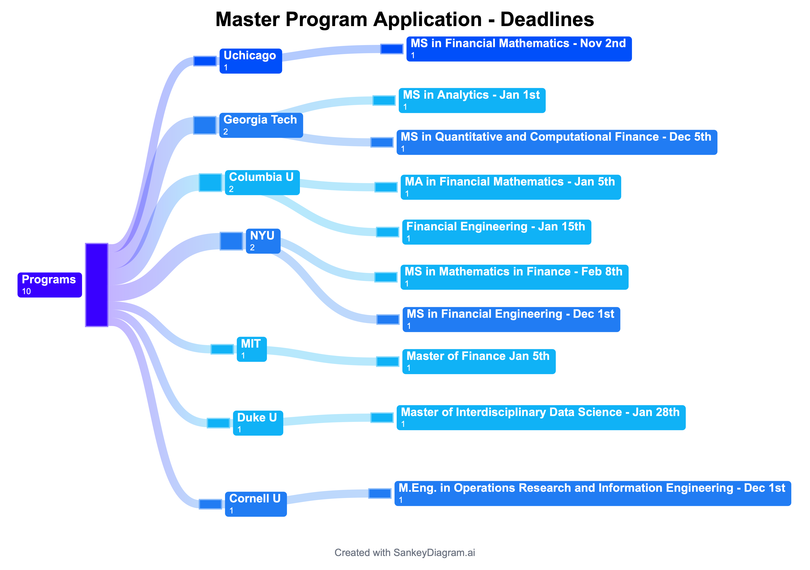

# Master's Applications

Hello, and welcome! I use this page to track my master's program applications for the 2026–27 cycle. I'll keep updating it as deadlines pass and decisions come in, so please check back anytime to follow my progress.

*Last updated: October 21, 2026*

## How to read the chart

- Read it from left to right: all programs, then each school, then each program with its deadline.
- **The darker the color, the closer the deadline:**
  - Darkest blue: November
  - Medium blue: December
  - Light blue: January–February
- A school's box takes the color of its earliest program deadline.
- The number under each box counts programs: 10 applications across 7 schools.

## Deadlines in order

| Deadline | School | Program | Status |
|---|---|---|---|
| Nov 2 | UChicago | MS in Financial Mathematics | Not submitted |
| Dec 1 | NYU | MS in Financial Engineering | Not submitted |
| Dec 1 | Cornell | M.Eng. in Operations Research and Information Engineering | Not submitted |
| Dec 5 | Georgia Tech | MS in Quantitative and Computational Finance | Not submitted |
| Jan 1 | Georgia Tech | MS in Analytics | Not submitted |
| Jan 5 | Columbia | MA in Mathematics of Finance | Not submitted |
| Jan 5 | MIT | Master of Finance | Not submitted |
| Jan 15 | Columbia | Financial Engineering | Not submitted |
| Jan 28 | Duke | Master of Interdisciplinary Data Science | Not submitted |
| Feb 8 | NYU | MS in Mathematics in Finance | Not submitted |
